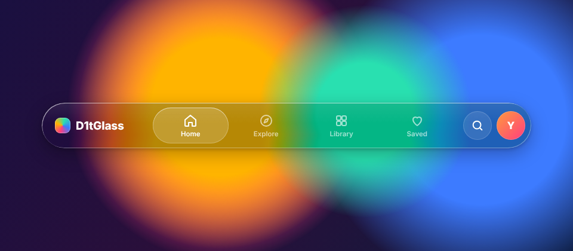

# refract.js

**Refractive glass for any HTML element** — edge refraction, chromatic aberration, a sliding tab pill and haptics. One file, zero dependencies, no build step.

<p align="center">
  <picture>
    <source srcset="docs/preview.webp" type="image/webp">
    
  </picture>
</p>

```html
<script src="refract.js"></script>

<header class="my-nav" data-refract>...</header>
```

That's it. The element keeps its own size, position and `border-radius` — refract.js only adds the glass.

**[▶ Live demo](https://d1tan4ik.github.io/D1tGlass/)**: a small social app (chats, contacts, profile) built with refract.js.

## Features

- 🔍 **Real refraction.** The background bends along the element's rounded edges, driven by a generated displacement map.
- 🌈 **Chromatic aberration.** The red, green and blue channels are displaced by different amounts, which gives the edges a subtle colour fringe.
- 💊 **Tab bar with a sliding pill.** The pill springs between tabs and grows while pressed. It also handles tabs of different widths.
- 📳 **Haptics.** Vibration API on Android, plus the native switch trick for Safari on iOS 18+.
- ⚡ **Automatic.** Elements added later (modals, toasts, AJAX content) are picked up automatically, and removed ones are cleaned up.
- 🎨 **Easy to override.** Library styles use `:where()` (zero specificity), so your CSS always wins.
- 🪶 **Lightweight.** ~20 KB unminified. Filters are shared between identical elements and recomputed only on resize.

## Installation

**Download.** Grab `refract.js` from the [latest release](../../releases/latest) and include it:

```html
<script src="/path/to/refract.js"></script>
```

**CDN (jsDelivr):**

```html
<script src="https://cdn.jsdelivr.net/gh/D1taN4ik/D1tGlass@1.0.1/refract.js"></script>
```

**Bundlers.** The file is UMD, so `require()` works. In the browser it exposes `window.Refract`:

```js
const Refract = require('./refract.js');
```

## Usage

### Attributes

| Attribute | Default | Description |
|---|---|---|
| `data-refract` | — | Enables the effect (or use the `refract` class) |
| `data-rf-scale` | `50` | Refraction strength |
| `data-rf-bezel` | `20` | Width of the curved edge zone, px |
| `data-rf-aberration` | `0.08` | RGB channel split, `0` disables it |
| `data-rf-blur` | `0.6` | Extra blur, px |
| `data-rf-saturate` | `170` | Saturation, % |
| `data-rf-brightness` | `1.06` | Brightness |
| `data-rf-tint` | — | Preset tint: `light`, `dark` or `clear` |
| `data-rf-press` | — | Springy scale-down on press |
| `data-rf-haptic` | — | Vibrate on press; the value sets the duration in ms (`data-rf-haptic="15"`) |
| `data-rf-tabs` | — | Turns the container into a tab bar with a sliding pill |

Attributes can be changed at any time, and the effect updates itself.

```html
<button class="btn" data-refract data-rf-press data-rf-haptic data-rf-tint="dark">
  Click me
</button>

<div class="card" data-refract data-rf-scale="70" data-rf-bezel="28">...</div>
```

### CSS custom properties

```css
.my-nav {
  --rf-tint: rgba(255, 255, 255, .1);      /* fill */
  --rf-highlight: rgba(255, 255, 255, .2); /* top highlight */
  --rf-border: rgba(255, 255, 255, .25);   /* inner border */
  --rf-fallback-blur: 20px;                /* blur in browsers without full support */
}
```

### Tab bar

```html
<nav class="tabbar" data-refract data-rf-tabs>
  <a href="/" class="is-active">Home</a>
  <a href="/search">Search</a>
  <a href="/profile">Profile</a>
</nav>
```

- **Tabs.** The tabs are the container's direct children. If any children have `data-rf-tab`, only those count as tabs.
- **Active tab.** Mark it with `.is-active` or `.active`, `aria-selected="true"` or `aria-current="page"`.
- **Haptics.** On by default; turn them off with `data-rf-haptic="off"` on the container.
- **Navigation.** Links behave normally. For SPAs, listen for the change event:

```js
nav.addEventListener('rf:change', (e) => {
  console.log(e.detail.index, e.detail.tab, e.detail.previous);
});
```

You can style the pill with these properties: `--rf-pill`, `--rf-pill-active`, `--rf-pill-inset`, `--rf-pill-radius` and `--rf-pill-grow` (e.g. `1.2 1.4`).

## JavaScript API

```js
Refract.apply(target, options); // Element | NodeList | Array | CSS selector
Refract.remove(target);
Refract.refresh(target);        // after changing border-radius from JS
Refract.tabs(container);        // → { index, select(i), layout(), element }
Refract.haptic(ms);
Refract.supported;              // true when the full effect is available
Refract.defaults;               // default options
Refract.init();                 // manual start
```

Options passed to `apply()` take precedence over `data-rf-*` attributes, and attributes take precedence over the defaults.

To disable auto-init, load the script with `data-rf-manual` and start it yourself:

```html
<script src="refract.js" data-rf-manual></script>
<script>Refract.init();</script>
```

## Browser support

| Browser | Result |
|---|---|
| Chrome, Edge, Opera, other Chromium browsers (desktop & Android) | Full effect |
| Safari, Firefox, all browsers on iOS | Frosted-glass fallback (`backdrop-filter: blur`) |

The full effect relies on SVG filters inside `backdrop-filter`, which only Chromium supports today. Other browsers get a clean blurred fallback, and nothing breaks.

**Haptics:**
- **Android:** Vibration API.
- **Safari on iOS 18+:** native switch trick.
- **Elsewhere:** skipped silently.

## How it works

1. **Displacement map.** For each element, refract.js draws a displacement map on a `<canvas>`. A signed distance field of the rounded rectangle gives the edge normals, and pixels inside the bezel band are pushed along them with smoothstep falloff. The center stays neutral.
2. **SVG filter.** The map feeds an SVG filter that runs three `feDisplacementMap` passes, one per colour channel, each with a slightly different scale. The passes are blended back together with `screen`, which produces the chromatic fringe.
3. **Applying it.** The filter is applied with `backdrop-filter: url(#…)`. A `ResizeObserver` regenerates it only when the element's size changes, and identical elements reuse the same filter.

## Demo

- **[Live demo](https://d1tan4ik.github.io/D1tGlass/)** ([`index.html`](index.html)) is a small social app with chats, contacts and a profile. It shows glass bars, the sliding tab pill, the message composer and haptics.
- **[Playground](https://d1tan4ik.github.io/D1tGlass/examples/)** ([`examples/index.html`](examples/index.html)) has buttons, cards, dynamic toasts and a draggable lens with live controls.

Open them in a Chromium browser for the full effect.

## License

[MIT](LICENSE)
